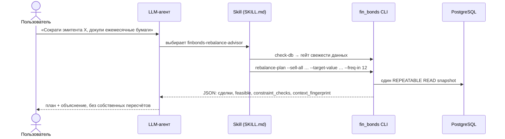
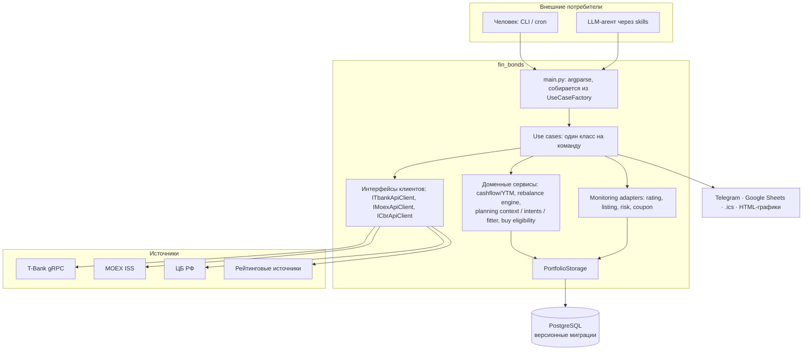

# fin_bonds

**Аналитика, мониторинг и ребалансировка портфеля облигаций Московской биржи — для человека и для AI-агента.**


> Полное руководство по командам — [doc/usage.md](doc/usage.md) · Подключение к агенту — [skills/README.md](skills/README.md)

---

fin_bonds собирает портфель из брокера (T-Bank) и рыночные данные (MOEX, ЦБ РФ, рейтинговые источники) в одну PostgreSQL-базу. Поверх неё — CLI с честной доходностью (YTM), мониторингом рисков, скринером облигаций и планировщиком ребалансировки. Тот же CLI подключается к LLM-агентам (Claude Code, Codex, OpenCode) через набор skills. Модель формулирует намерение, а количество бумаг, цены и лимиты считает детерминированное ядро.

- [Часть I. Функциональные возможности](#часть-i-функциональные-возможности)
  - [Что умеет](#что-умеет)
  - [AI-агенты и skills](#ai-агенты-и-skills)
  - [Быстрый старт](#быстрый-старт)
- [Часть II. Архитектурный дизайн](#часть-ii-архитектурный-дизайн)
  - [Слои и потоки данных](#слои-и-потоки-данных)
  - [Ключевые решения](#ключевые-решения)
  - [Структура репозитория](#структура-репозитория)
  - [Качество и поставка](#качество-и-поставка)
- [Документация](#документация)
- [Статус и лицензия](#статус-и-лицензия)

---

# Часть I. Функциональные возможности

## Что умеет

Частному инвестору в облигации приходится следить за офертами, понижениями рейтингов, купонами флоатеров и концентрацией на одном эмитенте. А «доходность» в интерфейсе брокера часто оказывается купонной ставкой. fin_bonds автоматизирует эту рутину:

| Задача | Что делает система | Команды |
|---|---|---|
| **Собрать данные** | Позиции и кэш по нескольким счетам T-Bank (gRPC API), каталог всех рублёвых облигаций с MOEX ISS, ставка RUONIA от ЦБ, рыночные цены. Поддерживаются фиксированный купон, флоатеры, амортизация и вечные бумаги. Выпуски привязываются к эмитентам | `sync-portfolio`, `update-bonds`, `update-market-prices`, `link-companies` |
| **Посчитать доходность честно** | Каноническая YTM по денежным потокам (к оферте или к погашению, горизонт указывается явно), дюрация, помесячный купонный доход. Если поток не определён (флоатер, вечная бумага, амортизация без графика), вместо фиктивного числа выводится «—» с причиной | `calculate-ytm`, `calculate-duration`, `calculate-monthly-profit`, `export-portfolio` |
| **Следить за рисками** | Подключаемые мониторы: кредитный рейтинг, уровень листинга MOEX, уровень риска брокера, купон флоатера. Плюс оферты и амортизации, ликвидность по стакану (оценка потерь при выходе из позиции), долговая нагрузка эмитентов. Алерты уходят в Telegram | `update-ratings`, `check-offers`, `analyze-liquidity`, `company-debt-report` |
| **Найти, что купить** | Скринер кандидатов вне портфеля с фильтрами по риску, сроку, частоте и типу купона. Сравнение чужой подборки (например, от LLM или из Telegram-канала) с портфелем: несопоставимое помечается статусом, а не превращается в сигнал | `analyze-buy-candidates`, `export-bonds`, `compare-external` |
| **Спланировать ребалансировку** | Единый JSON-отчёт (портфель, концентрации, топы скринера, погашения на 6 месяцев). Планировщик переводит намерения («продать всё», «довести позицию до N ₽») в целые количества с проверкой бюджета, лимита эмитента 15% и формальных ограничений. Есть A/B-сравнение альтернатив на одном срезе данных | `rebalance-report`, `rebalance-plan`, `rebalance-compare`, `rebalance-analysis-snapshot` |
| **Показать и поделиться** | Markdown/XLSX/CSV-экспорт со штампом свежести, интерактивные HTML-графики истории рейтингов и ликвидности, календарь оферт `.ics`, публикация снапшота портфеля в Google Sheet для ChatGPT | `export-portfolio`, `generate-plots`, `sync-offers-to-calendar`, `sync-chatgpt-portfolio` |

Полный справочник команд с флагами и примерами — [doc/usage.md](doc/usage.md) и [doc/commands/](doc/commands/README.md).

## AI-агенты и skills

LLM удобно спрашивать «что с моим портфелем» или «как снизить долю эмитента X», но арифметику она делает ненадёжно. Скажем, считает количество бумаг по цене из одного отчёта, а валидатор проверяет по цене из другого. Поэтому обязанности разделены:

> **Агент решает «что»** (намерения, ограничения, объяснение пользователю).
> **Ядро решает «сколько»** (цены, количества, лимиты, допустимость) и возвращает машиночитаемый JSON.



[skills/](skills/README.md) содержит 14 агент-нейтральных skills `finbonds-*` (стандарт `SKILL.md`: инструкции, SQL- и Python-скрипты). Их можно подключить к Claude Code, Codex, OpenCode или любому агенту, который читает `SKILL.md`:

| Группа | Skills |
|---|---|
| Данные и операции | `finbonds-ops` (карта команд и классов безопасности), `finbonds-data-refresh`, `finbonds-sql-recipes` |
| Риски | `finbonds-risk-monitoring`, `finbonds-risk-assessment`, `finbonds-ratings`, `finbonds-company-debt` |
| Решения | `finbonds-buy-candidates`, `finbonds-rebalance-advisor`, `finbonds-rebalance-tool` (типизированный адаптер к командам ребалансировки) |
| Отчёты | `finbonds-portfolio-summary`, `finbonds-portfolio-export`, `finbonds-event-calendar`, `finbonds-chatgpt-portfolio-export` |

Как обеспечена безопасность:

- **По умолчанию только чтение.** Команды, которые пишут в базу, запускаются лишь по явной просьбе пользователя. Классы команд описаны в `finbonds-ops`.
- **Белый список аргументов.** Адаптер ребалансировки не передаёт в shell произвольную строку. Агент может вызвать только разрешённые команды с типизированными флагами.
- **Песочница не может подменить данные.** `rebalance-analysis-snapshot` выдаёт агенту копию среза и непрозрачный `context_id`. Финальный план ядро считает по своему оригиналу, а не по данным, которые вернулись из песочницы.
- **Ответ агента тоже проверяется.** Например, [check_yield_wording.py](skills/scripts/check_yield_wording.py) ловит случай, когда купонную ставку назвали «доходностью» без горизонта.
- **Без секретов и личных данных.** В skills нет DSN, хостов и реальных ISIN, всё конкретное задаётся переменными окружения.

## Быстрый старт

```bash
git clone https://github.com/jedi108/fin_bonds.git && cd fin_bonds
python3 -m venv venv && source venv/bin/activate
pip install -r requirements.txt
cp env.example .env          # INVEST_TOKEN (T-Bank), POSTGRES_DSN, опционально TELEGRAM_*
```

```bash
python3 main.py migrate-db       # схема из migrations/postgres/, идемпотентно
python3 main.py sync-portfolio   # позиции из T-Bank
python3 main.py update-bonds     # каталог облигаций (T-Bank + MOEX)
python3 main.py export-portfolio --format md
python3 main.py rebalance-report --format json
```

Справка по любой команде: `python3 main.py <команда> --help`. Флаг `-v` включает подробные логи.
Регулярный мониторинг по расписанию (cron или systemd timer) описан в [doc/usage.md](doc/usage.md#автоматизация-и-планировщик-задач-cron). Подключение skills к агенту — в [skills/README.md](skills/README.md#установка).

---

# Часть II. Архитектурный дизайн

## Слои и потоки данных



Поток данных: **ingest** (sync/update из внешних API) → **PostgreSQL** (единственный источник правды) → **вычисления** (детерминированные сервисы над согласованным срезом) → **представление** (таблица, Markdown или JSON для агента).

## Ключевые решения

Каждое решение закрывает конкретный класс ошибок, которые встречались на практике.

**1. Команда = use case, CLI собирается автоматически.**
У каждой команды свой класс `UseCase` с `setup_parser()` и `execute()`. `UseCaseFactory` регистрирует их, а `main.py` строит из этой карты `argparse`. Чтобы добавить фичу, достаточно добавить класс: точка входа не меняется.

**2. Внешние API за интерфейсами (ports & adapters).**
Use cases зависят от абстракций в `src/use_cases/interfaces.py`, а не от SDK брокера или HTTP-клиента. Это позволяет тестировать без сети и заменить источник данных, не трогая бизнес-логику.

**3. Мониторинг через подключаемые адаптеры.**
Каждая метрика (рейтинг, листинг, риск, купон флоатера) реализована как `BaseAdapter`. Набор адаптеров включается списком в `config.yaml`, и новый монитор не меняет `update-ratings`.

**4. Один канонический калькулятор на каждую величину.**
YTM считает только cashflow-движок, а сценарии ребалансировки (доля эмитента, бюджет, купоны, ограничения) — только `RebalanceEngine`. Отчёт, план, сравнение и экспорт вызывают эти движки и не пересчитывают сами. Совпадение результатов проверяется тестами, например `test_report_export_equivalence`.

**5. `PlanningContext`: один срез, одно время, одна цена на ISIN.**
План и сравнение считаются по неизменяемому контексту, который собирается в одной read-only транзакции `REPEATABLE READ`. Время `as_of` фиксируется по началу транзакции, а не по часам Python, и для каждого ISIN задаётся одна расчётная цена с явным указанием её источника. Решение появилось после реальной ошибки: количество посчитали по цене 951.30, а валидатор проверял по 1103.06. Одинаковый вход даёт одинаковый `context_fingerprint`.

**6. Намерения → fitter → канонический валидатор.**
Агент или пользователь передаёт предметные намерения: `sell_all`, `target_value` с приоритетом. `planning_intents` нормализует их в типизированные DTO. `planning_fitter` переводит их в целые количества по единой цене, укладывает в бюджет и лимит эмитента и оставляет одну итоговую сделку на ISIN. Результат проверяет только канонический движок, второго валидатора нет.

**7. Контекстом владеет ядро.**
`EphemeralContextStore` выдаёт непрозрачный `context_id` (32 hex-символа). Артефакт привязан к инстансу приложения, хранится с правами 0600 и удаляется по TTL. Имя файла получается хешированием, поэтому path traversal невозможен. На чужой `context_id` и на несуществующий ответ одинаковый, так что существование чужого контекста не раскрывается. Песочница агента может читать копию данных, но не может подменить данные, по которым будет посчитан план.

**8. При сомнении — отказ (fail-closed) на всех границах данных.**
Перед аналитикой работает гейт свежести данных, общий для `check-db`, отчёта и плана. Неизвестное значение не становится нулём: YTM получает причину, рейтинг — статус (`missing`, `stale`, `conflicting` и др.). Внешние подборки не сопоставляются нечётко (fuzzy-match запрещён). Ошибка API брокера не превращается в «кэш = 0». Если синхронизация обнаружила неверный ID счёта, она прерывается до записи в базу.

**9. Схема — только через версионные миграции.**
Код не создаёт и не меняет схему при подключении. 17 SQL-миграций применяются идемпотентным раннером (`migrate-db`, `--status`, `--dry-run`), а деплой выполняет их как штатный шаг. Единицы хранения (проценты, ₽ и доля номинала) зафиксированы в [doc/units_conventions.md](doc/units_conventions.md).

**10. Skills — код, который проверяется.**
`make validate-skills` проверяет frontmatter, баланс `\if`/`\endif` и скобок в SQL, существование скриптов, на которые ссылается `SKILL.md`, и отсутствие привязки к конкретному агентскому рантайму. Таблицы, которых нет в миграциях, выдаются предупреждением. Проверка встроена в pre-commit hook.

## Структура репозитория

```
main.py                  точка входа CLI
src/
  use_cases/             по классу на команду, factory, интерфейсы клиентов
  services/              доменные движки: cashflow, rebalance_engine,
                         planning_context / intents / fitter, context_store,
                         buy_eligibility, external_comparison, company_debt
  monitoring/adapters/   подключаемые мониторы метрик
  tbank/ moex/ cbr/      клиенты внешних API
  storage.py             доступ к PostgreSQL
migrations/postgres/     версионные SQL-миграции
skills/                  агент-нейтральные skills + валидатор + pre-commit hook
doc/                     справочник команд, контракты данных, конвенции единиц
tests/                   pytest на отдельной тестовой БД
```

## Качество и поставка

- **Тесты.** Около 770 pytest-тестов (`make test`) гоняются на отдельной PostgreSQL-базе (`POSTGRES_DSN_TEST`). Они покрывают движки (YTM, дюрация, ребалансировка, fitter), контракты отчётов, идемпотентность записи истории рейтингов и граничные случаи данных брокера.
- **Контракты данных.** JSON-ответы версионированы (`contract_version`), а форматы внешних артефактов описаны отдельными документами: [Google Sheet для ChatGPT](doc/chatgpt_portfolio_sheet_contract.md), [долговая нагрузка эмитентов](doc/company_debt_contract.md), [ликвидность](doc/liquidity_architecture.md).
- **Поставка.** `make deploy` копирует код на хост через rsync и применяет миграции, а systemd timer запускает регулярный мониторинг. После деплоя выполняется smoke-проверка основного сценария, а не только проверка того, что команда завершилась.
- **Секреты.** Токены и DSN хранятся только в `.env` (он в `.gitignore`). В публичном коде и примерах используются синтетические ISIN и эмитенты.

---

## Документация

| Документ | О чём |
|---|---|
| [doc/usage.md](doc/usage.md) | Полное руководство: все команды, настройка БД, мониторинг, cron |
| [doc/commands/](doc/commands/README.md) | Справочник по отдельным командам |
| [skills/README.md](skills/README.md) | Установка и разработка agent skills |
| [doc/coupon_calculation.md](doc/coupon_calculation.md) · [doc/selling_vs_maturity.md](doc/selling_vs_maturity.md) | Методика расчётов |
| [doc/ytm_sql_examples.md](doc/ytm_sql_examples.md) · [doc/monthly_profit_sql_examples.md](doc/monthly_profit_sql_examples.md) | SQL-рецепты |
| [CHANGELOG.md](CHANGELOG.md) | История изменений |

## Статус и лицензия

Личный проект, открытый для портфолио; команды, схема и форматы могут меняться. Это инструмент анализа, а не инвестиционная рекомендация и не готовый финансовый продукт, без SLA. Заявок система не выставляет по замыслу: решения о сделках принимает пользователь.

Исходный код открыт для чтения, но **не распространяется под открытой лицензией**: права на повторное использование, изменение и распространение автоматически не предоставляются. Исключение — agent skills в [skills/](skills/README.md): они под MIT. Подробности — в [LICENSE](LICENSE).
